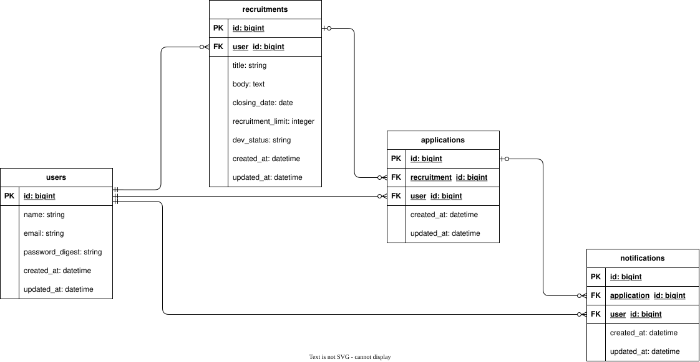

# データ設計

## ER図

  

## テーブル設計

### users

ユーザー情報を管理する。

| カラム | 型 | 制約 | 説明 |
|---|---|---|---|
| id | bigint | PK | 主キー |
| name | string | null: false | ユーザー名 |
| email_address | string | null: false, unique: true | メールアドレス |
| password_digest | string | null: false | ハッシュ化したパスワード |
| created_at | datetime | null: false | 作成日時 |
| updated_at | datetime | null: false | 更新日時 |

### sessions

どのユーザーがログインしているかを管理する。

| カラム | 型 | 制約 | 説明 |
|---|---|---|---|
| id | bigint | PK | 主キー |
| user_id | bigint | FK | 外部キー |
| created_at | datetime | null: false | 作成日時 |
| updated_at | datetime | null: false | 更新日時 |

### recruitments

募集内容を管理する。

| カラム | 型 | 制約 | 説明 |
|---|---|---|---|
| id | bigint | PK | 主キー |
| user_id | bigint | FK | 外部キー（募集を作成したユーザー） |
| title | string | null: false | タイトル |
| body | text |  | 募集内容 |
| closing_date | date | null: false | 締切日 |
| positions_count | integer | null: false | 募集人数 |
| required_status | string | null: false | 応募者の状態 |
| accepting_applications | boolean | null: false, default: true | 応募を受け付けているかどうか |
| created_at | datetime | null: false | 作成日時 |
| updated_at | datetime | null: false | 更新日時 |

### applications

募集への応募を管理する。

| カラム | 型 | 制約 | 説明 |
|---|---|---|---|
| id | bigint | PK | 主キー |
| user_id | bigint | FK | 外部キー（応募したユーザー） |
| recruitment_id | bigint | FK | 外部キー（応募先の募集） |
| status | string | null: false, default: "応募済み・承認待ち" | 応募状況 |
| created_at | datetime | null: false | 作成日時 |
| updated_at | datetime | null: false | 更新日時 |

### notifications

応募後に募集者に届く通知を管理する。

| カラム | 型 | 制約 | 説明 |
|---|---|---|---|
| id | bigint | PK | 主キー |
| user_id | bigint | FK | 外部キー（通知を受け取るユーザー: 募集者） |
| application_id | bigint | FK | 外部キー（通知原因の応募） |
| created_at | datetime | null: false | 作成日時 |
| updated_at | datetime | null: false | 更新日時 |
