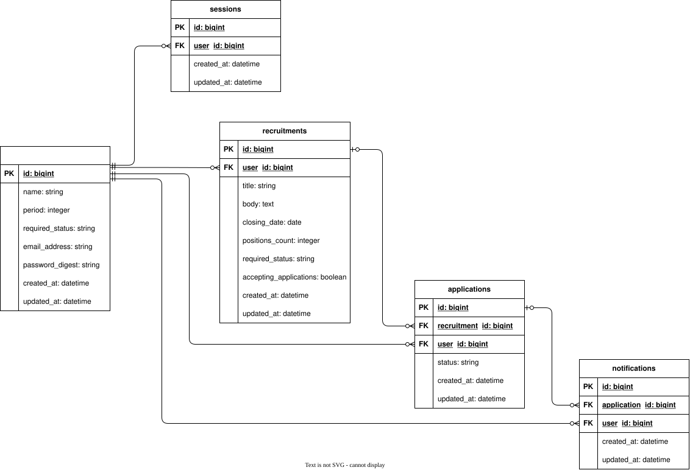

# データ設計

## ER図

  

## テーブル設計

### users

ユーザー情報を管理する。

| カラム | 型 | 制約 | 説明 |
|---|---|---|---|
| id | bigint | PK | 主キー |
| name | string | null: false | ユーザー名 |
| period | integer | null: false | 期 |
| required_status | string | null: false | 学習ステータス |
| email_address | string | null: false, unique: true | メールアドレス |
| password_digest | string | null: false | ハッシュ化したパスワード |
| created_at | datetime | null: false | 作成日時 |
| updated_at | datetime | null: false | 更新日時 |

### sessions

どのユーザーがログインしているかを管理する。

| カラム | 型 | 制約 | 説明 |
|---|---|---|---|
| id | bigint | PK | 主キー |
| user_id | bigint | FK | 外部キー |
| created_at | datetime | null: false | 作成日時 |
| updated_at | datetime | null: false | 更新日時 |

### recruitments

募集内容を管理する。

| カラム | 型 | 制約 | 説明 |
|---|---|---|---|
| id | bigint | PK | 主キー |
| user_id | bigint | FK | 外部キー（募集を作成したユーザー） |
| title | string | null: false | タイトル |
| body | text |  | 募集内容 |
| closing_date | date | null: false | 締切日 |
| positions_count | integer | null: false | 募集人数 |
| required_status | string | null: false | 応募者の状態 |
| accepting_applications | boolean | null: false, default: true | 応募を受け付けているかどうか |
| created_at | datetime | null: false | 作成日時 |
| updated_at | datetime | null: false | 更新日時 |

#### required_status の値（enum）

| 値 | 意味 |
|---|---|
| basic_step_completed | 基礎STEP完了 |
| advanced_step_completed | 応用STEP完了 |
| graduated | 卒業済み |

### applications

募集への応募を管理する。

外部キーの組み合わせにはユニーク制約をつける。

| カラム | 型 | 制約 | 説明 |
|---|---|---|---|
| id | bigint | PK | 主キー |
| user_id | bigint | FK | 外部キー（応募したユーザー） |
| recruitment_id | bigint | FK | 外部キー（応募先の募集） |
| status | string | null: false, default: "pending" | 応募状況 |
| created_at | datetime | null: false | 作成日時 |
| updated_at | datetime | null: false | 更新日時 |

#### applications_status の値（enum）

| 値 | 意味 |
|---|---|
| pending | 承認待ち |
| approved | 承認 |
| rejected | 却下 |

### notifications

応募、承認、見送りをアプリ内で通知する。

同じ応募、同じactionの通知を1件までとする。

| カラム | 型 | 制約 | 説明 |
|---|---|---|---|
| id | bigint | PK | 主キー |
| recipient_id | bigint | FK, null: false | 外部キー（通知を受け取るユーザー: 募集者） |
| actor_id | bigint | FK, null: false | 外部キー（通知の発生元ユーザー: 応募者） |
| application_id | bigint | FK, null: false | 外部キー（対象の応募） |
| action | string | null: false | 通知種別 |
| read_at | datetime | なし | 既読日時(nil = 未読) |
| created_at | datetime | null: false | 作成日時 |
| updated_at | datetime | null: false | 更新日時 |

#### notifications_actionの値(enum)

| 値 | 意味 | 受信者 |
|---|---|---|
| applied | 応募があった | 募集者 |
| approved | 応募が承認された | 応募者 |
| rejected | 応募が見送られた | 応募者 |
