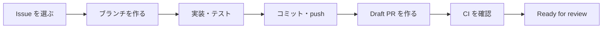

# 開発の進め方（最初の Pull Request まで）

[開発環境の構築](setup.md) が終わったら、この手順で1つの Issue を実装して Pull Request（PR）を出すところまで進めます。
ルールの詳しい説明は [キックオフ資料](../kickoff.md) の (5)〜(8) にあります。

## 全体の流れ



## 1. 最初に読むもの

| 順番 | ドキュメント | 読む目的 |
|---|---|---|
| 1 | [キックオフ資料](../kickoff.md) | 目的・体制・開発ルール |
| 2 | [要件定義](../requirements.md) | 誰のための何のアプリか、各機能の受入条件 |
| 3 | [画面設計](../screens.md) | 画面一覧と画面遷移 |
| 4 | [データ設計](../data-model.md) | テーブルとカラム |

## 2. Issue を選ぶ

1. [カンバンの URL](https://github.com/users/tnakamura0/projects/9) を開く
2. Ready 列の Issue から担当を決め、Issue の Assignees に自分を設定する
3. Issue 本文の受入条件を読み、何ができれば完了かを確かめる。わからないことは着手前に質問する

## 3. ブランチを作る

ブランチ名は英語で書き、先頭に種類を表す prefix を付け、続けて Issue 番号と短い説明をつなげます。

| prefix | 用途 |
|---|---|
| **epic** | エピックブランチ |
| **feature** | ユーザーが触れる新機能の実装 |
| **chore** | ユーザーが触れない開発者向けの変更 |
| **fix** | バグの修正 |
| **docs** | ドキュメントの修正 |
| **refactor** | リファクタリング |

```bash
# エピックの子 Issue の場合： エピックブランチから作る

# リモートの最新情報を取得
$ git fetch origin

# エピックブランチから feature ブランチを作成
# --no-track で作成時にUpstreamを設定しないようにする。初回push時に -u で設定する
$ git switch --no-track -c feature/<Issue 番号>-<短い英語の説明> origin/epic/<エピック番号>-<説明>
```

```bash
# エピックではない場合：main から作る

# mainブランチに切り替える
$ git switch main

# main を最新化
# --ff-only で意図しないマージコミットを防ぐ
git pull --ff-only origin main

# feature ブランチを作成
$ git switch -c feature/<Issue 番号>-<短い英語の説明>
```

```bash
# 具体例

# エピックの子 Issue の場合
git fetch origin
git switch --no-track -c feature/25-google-login origin/epic/10-authentication

# エピックではない場合
git switch main
git pull --ff-only origin main
git switch -c feature/30-update-header
```

## 4. 実装する

- 受入条件 → テスト → 実装の順に進める。書き方は `spec/` の既存のテストを参考にする
- 仕様と違う作りになったときは、同じ PR で `docs/` も直す
- コミット、push前にローカルでCIを実行する

```bash
# ローカルでCIを実行
$ docker compose exec web bundle exec bin/ci

# 特定のファイルのテストのみ実行
docker compose exec web bundle exec rspec spec/models/user_spec.rb
# 特定の行のテストのみ実行
docker compose exec web bundle exec rspec spec/models/user_spec.rb:25

# Lintエラーを自動修正
$ docker compose exec web bin/rubocop -a
```

## 5. コミットして push する

コミットメッセージは`<prefix>: <要約>`の形で書きます。`<prefix>`は英語の決まった単語から選び、`<要約>`は日本語で書きます。

| prefix | 使うとき | 例 |
|---|---|---|
| `feat` | 機能を追加した | `feat: 投稿にいいねボタンを表示する` |
| `fix` | 不具合を直した | `fix: ヘッダーの表示崩れを直す` |
| `refactor` | 動きを変えずにコードを整理した | `refactor: いいね数の集計をモデルに移す` |
| `test` | テストだけを追加・修正した | `test: いいねの取り消しのテストを追加する` |
| `docs` | ドキュメントだけを変更した | `docs: 画面一覧にいいねの操作を追記する` |
| `chore` | 設定・依存関係など、上のどれにも当たらない変更 | `chore: gem を更新する` |

```bash
# 現在のブランチを確認
git branch --show-current

# 開発・変更後に状態を確認
git status

# コミットするファイルをステージング
git add <ファイル名>

# ステージングした差分を確認
git diff --staged

# コミット
git commit -m "<prefix>: <コミットメッセージ>"

# リモートにPush
git push -u origin HEAD
```

## 6. Draft PR を作る

最初は必ず Draft（下書き）で作ります。向き先（base）は、エピックの子 Issue ならエピックブランチ、そうでなければ `main` です。

```bash
$ gh pr create --draft --base epic/<エピック番号>-<説明>   # エピックの子 Issue
$ gh pr create --draft --base main                      # エピックではない場合
```

本文には PR テンプレートが自動で入ります。`Closes #<Issue 番号>`を必ず書きます。

## 7. CI を確認して Ready for review にする

1. PR のチェックがすべて緑になるのを待つ。赤になったら Details でエラーを確かめ、直して push し直す
2. PR テンプレートのセルフチェックをする
3. Ready for review を押す

| 向き先 | マージの条件 |
|---|---|
| エピックブランチ | CI がすべて緑 |
| `main` | CI がすべて緑 ＋ レビュー承認 <1> 名 |

## 8. マージされたら

```bash
$ git switch main
$ git pull
$ git branch -d feature/<Issue 番号>-<説明>
# Squash mergeの場合
$ git branch -D feature/<Issue 番号>-<説明>
```

カンバンのカードが Done に移っていることを確かめて、次の Issue に進みます。

## 困ったとき

- 1時間調べても進まなければ、Discord の相談・質問 で質問する
- 環境のトラブルは [開発環境の構築](setup.md) の「うまくいかないとき」
- Git の操作で迷ったら、何かを消したり上書きしたりする前に相談する（`git reset --hard` や `git push --force` は使わない）
