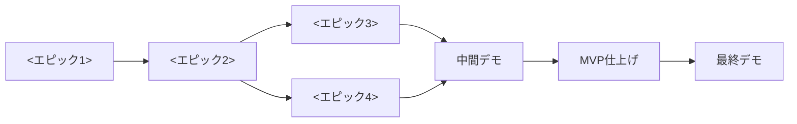

# キックオフ資料 — <プロダクト名>

## (1) プロダクトの目的とゴール

### 解決したい課題
<誰が、どんな場面で、何に困っているか。例：独学で学習している人が、学習の記録を続けられず、仲間の進み具えないため、学習が途切れがちになる>

チーム開発を募集できるアプリ

### プロダクトのゴール
<このプロダクトで、ユーザーが何をできるようになるか>

### 成功の条件
| 観点 | 条件 |
|---|---|
| 体験 | <ユーザーが何を、どのくらいの手間でできるか。例：ログインしてから迷わずに学習記録を1件投稿できる> |
| 品質 | <確かめられる品質の条件。例：主要な流れのテストが CI で通っている> |
| 運用 | <使い続けられる条件。例：投稿の編集・削除を、ユーザーが自分でできる> |

### MVP の範囲
| 区分 | 内容 |
|---|---|
| MVP | 会員登録・ログイン、募集の作成・表示・編集・削除、一覧、申込、通知、SNS共有 |
| 拡張（時間があれば） | メール通知、いいね |
| 対象外 | <例：通知、外部サービスとの連携、モバイルアプリ> |

## (2) チームの役割と責任範囲

| 役割 | 担当 | 責任範囲 | 主に見るもの | 判断すること |
|---|---|---|---|---|
| プロダクトマネージャー（PdM） | @エリュさん | 要件定義・優先順位・受入判断 | `docs/requirements.md`、カンバンの Backlog / Ready、デモ | 何を作るか・作らないか、機能の受入 OK／NG |
| プロジェクトマネージャー（PjM） | @かるめ | スケジュール・進捗・リスク管理 | カンバン全体、マイルストーン | スコープ調整の提案、停滞したときのエスカレーション |
| テックリード（TL） | @オオカミさん | 設計・技術選定・コード品質 | PR、`docs/data-model.md` | 設計方針、PR の最終承認、技術的な優先度 |
| エンジニアメンバー | @みんな | 実装・テスト・PR 作成・レビュー | 担当 Issue、PR | 実装方法（設計方針の範囲内） |

### 相談先
| 困りごと | 相談先 |
|---|---|
| 仕様があいまい／要件の解釈に迷う | PdM |
| 期限に間に合わない／作業が重なっている | PjM |
| 設計・実装方針・技術的に詰まった | TL |
| 環境構築・ツールの使い方 | エンジニアメンバー同士 → 解決しなければ TL |

## (3) スケジュールとマイルストーン
期間：<開始日>〜<終了日>（<例：2週間、作業日10日>）

3週間、作業日15日

MVP をエピック単位に分け、依存関係から逆算してマイルストーンを置く。

| 日程 | マイルストーン（期限） | エピック | 完了の目安 |
|---|---|---|---|
| <D1–D3> | M1 <例：認証>（<期限>） | <例：会員登録・ログイン・ログアウト> | <例：ログインして自分の画面に入れる> |
| <D4–D5> | M2 <例：投稿>（<期限>） | <例：投稿の作成・表示・編集・削除> | <例：自分の投稿を作成・編集・削除できる> |
| <D6–D7> | M3 <例：一覧・いいね>（<期限>） | <例：投稿一覧／いいね ※並行> | <例：一覧で他人の投稿を見て、いいねできる> |
| <D8> | 中間デモ | — | 主要な流れを通しで見せ、PdM が受入判断。残った課題の優先度を付ける |
| <D8–D9> | M4 MVP 完成（<期限>） | <例：MVP 仕上げ> | <例：受入条件をすべて満たし、通しで確認できる>|
| <D10> | 最終デモ | — | リリース判断、ふりかえり |



- クリティカルパスは「<エピック1> → <エピック2> → <エピック3> → MVP 仕上げ」。ここが遅れると最終デモに影響するため、遅れが見えた時点で PjM が並行エピックから人を回すか、スコープを調整する
- 各エピックは着手時に子 Issue へ分解する（(6) 開発フロー）
- マイルストーンと期限は GitHub の Milestones で管理する
- 拡張機能は MVP のあとに別エピックとして扱う

### 定例
- 夜会：<時刻と長さ。例：毎朝15分。定めない場合は「定めない」と書く>
- ふりかえり：<例：各マイルストーンの区切りと、中間デモ・最終デモのあと>
- 打ち合わせが必要になったら： チャットで声をかけ、通話ツールで行う

#### KPTふりかえりテンプレート

```text
# KPTふりかえり

対象：〇〇プロジェクト（またはマイルストーン名・期間）

実施日：YYYY/MM/DD
ファシリテーター：@誰が進行したか
参加メンバー：@member1 @member2 ...

---

## Keep（うまくいったこと／今後も続けたいこと）

- 例）朝会で進捗を共有しやすかった
- 例）PRテンプレートでレビューが明確だった
- 例）レビュー依頼のSlackルールが機能していた

---

## Problem（困ったこと／課題／引っかかった点）

- 例）タスクが粒度大きく、完了の見通しが立てづらかった
- 例）レビューの依頼タイミングがバラついた
- 例）CIでのRuboCopエラーを見逃しがちだった

---

## Try（次に試したいこと／改善アイデア）

- タスクに「完了条件」を書く運用を試してみる
- PRに「レビュー希望日時」欄を加える
- #reviewチャンネルに「対応期限」も記載する

---

## 次回ふりかえりで確認するTry項目

- [ ] タスクの完了条件が明記されたか？
- [ ] レビュー依頼のタイミングが改善されたか？
- [ ] CIのエラー確認の仕組みがチーム内に浸透したか？
```

## (4) 技術スタックと開発環境

| 区分 | 採用技術 |
|---|---|
| 言語 / フレームワーク | Ruby 3.4.12 / Ruby on Rails 8.1.4 |
| フロント | TailwindCSS v4, Hotwire |
| DB | PostgreSQL 17 |
| テスト | RSpec、FactoryBot、Capybara、WebMock、SimpleCov |
| 品質 | RuboCop、Brakeman、bundler-audit, Bullet |
| 環境 | Docker Compose web / db / css |

セットアップの手順は [開発環境の構築](dev/setup.md) を参照。

## (5) 命名規則・Lint・コードスタイル

- Rails 標準の命名に従う（モデルは単数形 `Post`、テーブル・コントローラーは複数形 `posts` / `PostsController`、ファイルはスネークケース）
- 1つのモデルで閉じる処理はモデルに寄せ、複数のモデルにまたがる処理や外部サービスの呼び出しは`app/services/` に置く
- コントローラーは REST の7アクションに収める。それ以外の操作はリソースとして切り出す（例：いいね → `LikesController#create` / `#destroy`）
- Lint は RuboCop（`.rubocop.yml`） 。CI で違反があればマージしない
- RSpec の `describe` / `it` は日本語で書いてよい
- コミットメッセージ：`<種別>: <要約>`（種別：`feat` / `fix` / `refactor` / `test` / `docs` / `chore`）

## (6) 開発フロー（GitHub Flow ＋エピックブランチ）

大きな要件はエピックとして扱い、子 Issue に分解して進める。

| ブランチ | 作成元 | 命名 |
|---|---|---|
| `main` | — | 常設。常に動く状態を保つ |
| エピックブランチ | `main` | `epic/<エピックの Issue 番号>-<短い説明>` |
| 作業ブランチ | エピックブランチ | `feature/<子 Issue 番号>-<短い説明>`（不具合修正は `fix/`、整理は`refactor/`） |

| マージ | 条件 | 方法 |
|---|---|---|
| 子 PR → エピックブランチ | CI がすべて緑 ＋ レビュー承認 1名 | Squash merge |
| エピックブランチ → `main` | CI がすべて緑 ＋ レビュー承認 1名（設計に関わる変更は TL の承認が必須） | Merge commit |
| 小さな修正 → `main` | CI がすべて緑 ＋ レビュー承認 1名 | Squash merge |

- `main` に入る変更は、必ず実装者以外の目を通る（慣れるまでは子 PR にもレビューを付ける）

- PR は Draft で作成し、CI が通ってセルフチェックが済んだら Ready for review にする
- 子 PR の本文に `Closes #<子 Issue 番号 >` を書く。向き先が `main` ではないため、この時点では Issueは閉じない。エピックブランチから `main` への統合 PR の本文に、エピックとすべての子 Issue の`Closes` を並べ、`main` へのマージでまとめて閉じる
- エピックにするほどではない小さな修正は、`main` から作業ブランチを作り、`main` 向けの PR を出す
- 仕様と実装が変わったら、同じ PR で `docs/` も直す

## (7) テストコード方針
| 種類 | 置き場所 | 何を書くか | 優先度 |
|---|---|---|---|
| Model spec | `spec/models` | バリデーション・スコープ・関連 | ◎ 最初に書く |
| Service spec | `spec/services` | 複数モデルにまたがる処理、外部サービスの呼び出し（スタブで） | ◎ |
| Request spec | `spec/requests` | 認可（他人の投稿を編集・削除できない）、ステータスコード | ◎ |
| System spec | `spec/system` | 主要な流れのみ（<例：会員登録 → 投稿 → 一覧 → いいね>） | △ 最小限 |

- 受入条件をテストケースに落としてから実装する（Red → Green → Refactor）
- 外部への通信は WebMock ですべて遮断する
- CI（GitHub Actions）で RuboCop・Brakeman・RSpec を実行する。すべて緑でないとマージしない
- カバレッジ：<例：行カバレッジ80%> を目安にするが、参考値として扱う。数値を上げるためだけのテストは書かず、カバレッジ不足でマージを止めることもしない

## (8) タスク管理と運用ルール

### カンバン（GitHub Projects）
<カンバンの URL>（マイルストーンは <Milestones の URL>）

| 列 | 意味 | 入れる人 |
|---|---|---|
| Backlog | アイデア・未整理 | 誰でも |
| Ready | 受入条件が書かれ、着手できる | PdM（優先度順に並べる） |
| In Progress | 作業中 | 担当者 |
| Review | PR のレビュー待ち | 担当者 |
| Done | マージ済み | 自動 |

- WIP 制限：In Progress は1人2枚まで
- Issue には受入条件（チェックリスト）を必ず書く（Issue フォームを使う）
- Issue は <半日〜1日> で終わる大きさに分ける

### 停滞したときのルール
| 状況 | アクション |
|---|---|
| 1時間調べても解決しない | チャットで質問する（(9) の質問のテンプレート） |
| カードが2日動かない | チャットで状況を共有する。PjM が分割・担当変更を提案する |
| マイルストーンに間に合わない見込み | わかった時点で PjM に連絡 → PdM とスコープを調整する |

## (9) コミュニケーションルール

### チャンネル
| 場所 | 使い方 |
|---|---|
| Discordサーバー | 開発の相談・質問 |
| pr通知チャンネル | レビュー依頼。PR のリンクを添えて投稿する |
| <#random> | 雑談 |

### 質問のしかた
- 個別の DM ではなく、チャンネルで質問する（ほかの人の学びになる）
- 返信はスレッドで行う
- 質問のテンプレートで書く

### 質問のテンプレート

```text
【やりたいこと】
【起きていること】（エラーメッセージはコードブロックで）
【試したこと】
【仮説】
【関連 Issue / PR】#<番号>
```

### ミーティング
Discord
