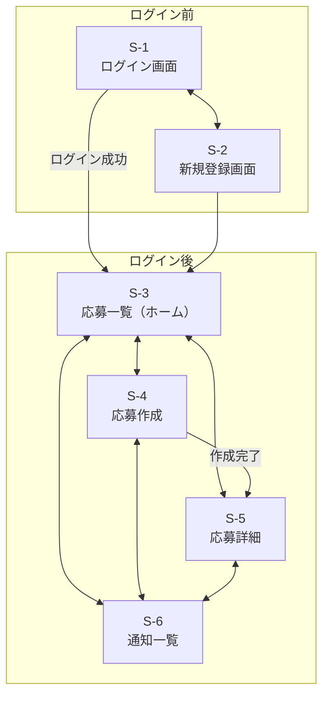

# 画面設計

## 画面一覧
| ID | 画面名 | URL | ログイン | 対応UC |
|---|---|---|---|---|
| S-1 | ログイン | `/session/new` | 不要 | UC-3 |
| S-2 | 新規登録 | `registration/new` | 不要 | UC-3 |
| S-3 | 応募一覧（ホーム） | `/` | 不要 | UC-2 |
| S-4 | 応募作成・編集 | `/recruits/new`ほか | 必要 | UC-5 |
| S-5 | 応募詳細 | `/recruits/:id` | 不要 | UC-1, UC-2, UC-4 |
| S-6 | 通知一覧 | `/notifications` | 必要 | UC-6 |

## 画面遷移図

